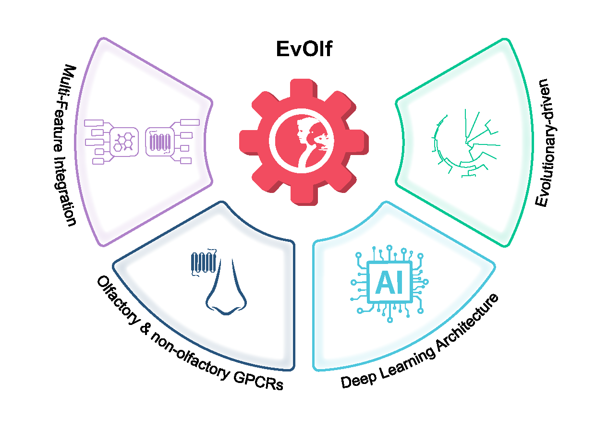

> **Recognising molecular interactions across the mammalian GPCRome.** EvOlf is an
> evolution-guided deep learning framework for predicting ligand–GPCR interactions and
> deorphanising receptors across 20+ mammalian species.

---

## Why this problem matters

G protein-coupled receptors are the largest family of drug targets, yet most remain orphan
receptors — their endogenous ligands and activating molecules unknown. Predicting which
ligands engage which receptors, across species and across both odorant and non-odorant
GPCRs, would open vast unexplored chemical–receptor space to drug discovery.

## Scientific question

*Can evolutionary information improve molecular recognition models across the mammalian
GPCRome — and help deorphanise receptors we cannot yet assign ligands to?*

## Concept

<div align="center">
  
</div>

## What the system does

EvOlf predicts ligand–GPCR interactions by integrating odorant (OR) and non-odorant GPCRs
across **20+ species**, using evolutionary insights for accurate predictions and receptor
**deorphanisation**. Explore the complete training/validation interaction dataset on the
[EvOlf Web Server](https://evolf.ahujalab.iiitd.edu.in/), or run predictions on your own data
through the web-hosted [prediction model](https://evolf.ahujalab.iiitd.edu.in/prediction) or
the local Nextflow pipeline.

## Main methodological contributions

- Evolutionary-guided deep learning architecture for GPCRome-scale agonist prediction
- Unified modelling of odorant and non-odorant GPCRs across 20+ species
- Nextflow pipeline: molecular featurisation → protein embeddings (ChemBERTa, ProtBERT, ProtT5) → deep-learning inference
- Deployable on local machines, HPC clusters, and the cloud (Docker / Apptainer / GPU profiles)
- Outputs reusable **ligand, receptor, and pair embeddings** for downstream ML

## Benchmark & validation

The EvOlf dataset of ligand–receptor interactions used for training and validation is
browsable on the [web server](https://evolf.ahujalab.iiitd.edu.in/). Detailed benchmarks
accompany the forthcoming manuscript.

## Installation

**Prerequisites:** a container engine ([Docker](https://docs.docker.com/engine/install/) or
[Apptainer](https://apptainer.org/)) and [Nextflow](https://nextflow.io/):

```bash
conda create -n nf-env -c bioconda nextflow
```

## Quick start

Prepare a CSV with one ligand–receptor pair per row (SMILES + receptor amino-acid sequence;
unique IDs optional — EvOlf can generate them). For best accuracy, canonicalise SMILES first
with OpenBabel:

```bash
obabel -ismi input.smi -ocan -O out.smi
```

Run the pipeline:

```bash
nextflow run the-ahuja-lab/evolf-pipeline \
  --inputFile "data/my_experiment.csv" \
  --ligandSmiles "SMILES" \
  --receptorSequence "Sequence" \
  --outdir "./results/experiment_1" \
  -profile docker,gpu
```

## Examples

**Batch mode (high-throughput, multiple datasets):**

```bash
nextflow run the-ahuja-lab/evolf-pipeline \
  --batchFile "batch_manifest.csv" \
  --outdir "./results/batch_run" \
  -profile docker
```

**Hardware profiles:** `docker` · `apptainer`/`singularity` · `gpu` (highly recommended —
enables CUDA for ChemBERTa, ProtBERT, ProtT5, and the prediction model).

## Reproducibility

- All container images are public on [DockerHub (ahujalab)](https://hub.docker.com/u/ahujalab)
- Model weights (~15 GB, Hugging Face transformers) are downloaded once and cached in `~/.evolf_cache`
- Default resource limits (4 CPUs / 16 GB RAM) are configurable via `--maxCPUs` and `--maxMemory`
- Outputs: `Prediction_Output.csv` (interaction labels + confidence), `Input_ID_Information.csv`, and ligand / receptor / pair embeddings
- Full pipeline documentation: [`evolf-pipeline-source`](https://github.com/the-ahuja-lab/EvOlf/tree/main/evolf-pipeline-source)

## Citation

Citation details will be added with the forthcoming manuscript.

## Team

[The Ahuja Lab](https://github.com/the-ahuja-lab) — computational biology and molecular AI.

## License

MIT — see [`LICENSE`](LICENSE).
